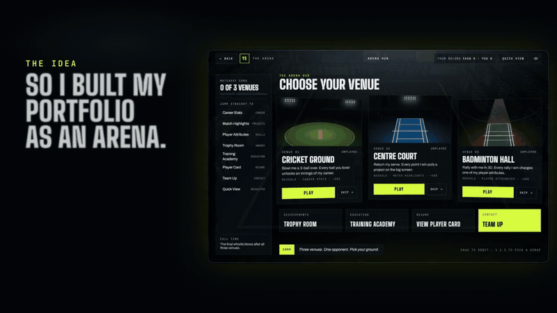

# Arena: Yash Sarda's portfolio

**A portfolio you play.** Walk into the arena, play three short games against me, and find out who I am while you do.

<!-- The film: a short preview that plays right here; it links to the full video with sound. -->

[Watch the full film with sound](docs/media/arena.mp4)

## Why an arena?

I have been a sports person since I was a kid. I played a lot of cricket, tennis and badminton, and I was really good at all three. Those games taught me to stay calm under pressure, to read the other side, and to keep going after a bad point. I still think like that when I write code.

So when it was time to build my portfolio, a plain page with a list of projects felt wrong. I wanted it to feel like the places I grew up in: the floodlights coming on, the crowd, the scoreboard. So I built it as an arena, and each sport tells one part of my story.

| The game | What it shows about me |
| --- | --- |
| **Cricket**: you bowl, three balls | My career, one innings per ball: college, my internship and my work as a software engineer |
| **Tennis**: you return my serve | My projects, one for each point I win |
| **Badminton**: you rally against me | My skills, charged up one rally at a time: backend, frontend, data, and AI & craft |

After all three, a scoreboard says **You 0, Yash 3**, with a "good try". It is my portfolio, so I always win.

## If you don't feel like playing

Every page can also be read without a game. **Quick View** is the 90 second version of everything: who I am, where I have worked, what I have built and how to reach me.

## What's inside

- **Career Stats**: where I studied and where I have worked, newest first
- **Match Highlights**: my best projects, with what each one does and the stack behind it
- **Player Attributes**: my skills, split into what I use at work and what I have built on my own
- **Trophy Room**: the things I am proud of
- **Player Card**: my whole resume on one card, with a download
- **Team Up**: the easy way to get in touch

## Made to work for everyone

It runs on a laptop and on a phone. The games are in 3D, and phones get a lighter version. If your device can't run 3D, or you ask for less motion, you get a simple 2D version of the same games instead. You can play with only a keyboard, and the pages work with a screen reader.

## Built with

React, React Router, TypeScript, Tailwind CSS and Three.js (through React Three Fiber). The sounds are made in code or come from free recordings, and the games run on small scripts I wrote myself, so there is no game engine. The code is tested with Vitest and Playwright and built in Storybook.

## Credits

- **The film's music:** *Happy Beats, Business Moves Vol. 12* by Sascha Ende ([ende.app](https://ende.app)), licensed [CC BY 4.0](https://creativecommons.org/licenses/by/4.0/).
- **The 3D players and their moves:** Universal Base Characters and Universal Animation Library by [Quaternius](https://quaternius.itch.io/), CC0.
- **The crowd, bat, ball and shuttle sounds:** free recordings from [Freesound](https://freesound.org), CC0. Each one is listed in [`public/audio/CREDITS.md`](public/audio/CREDITS.md).

## Say hello

Hiring, building something, or just want a rematch? Use the **Team Up** page, or find me here:

- Email: [yashsarda2002@gmail.com](mailto:yashsarda2002@gmail.com)
- LinkedIn: [linkedin.com/in/yash-sarda2107](https://www.linkedin.com/in/yash-sarda2107)
- GitHub: [github.com/yashsarda21](https://github.com/yashsarda21)
